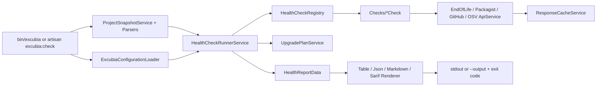
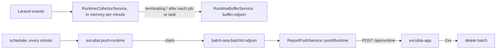
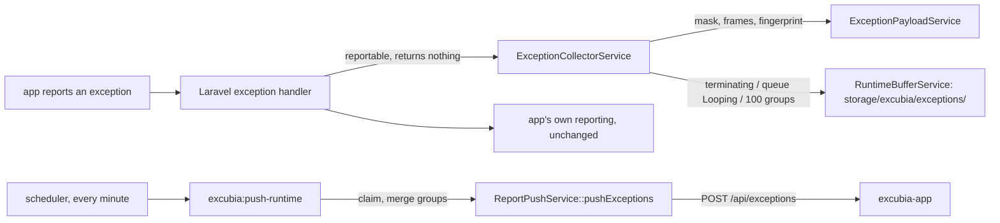

# Excubia — Architecture v0.1.0

Composer package: `qiick/excubia-core`. Install with `composer require qiick/excubia-core` (not `--dev`). The CLI binary stays `bin/excubia`. Opt-in runtime monitoring (Phase B) lives in this package; there is no separate `qiick/excubia-probe`. The multi-project dashboard is the separate app `qiick-io/excubia-app`.

> Companion to `docs/SPEC.md`. Follows "Codice Perfetto" (`knowledge/conventions/code-quality.md`): `declare(strict_types=1)` everywhere, explicit role suffixes, readonly `*Data` value objects, full English docblocks (why + array shapes + side effects + `@throws`), no abbreviations, boolean `is/has/can/should` prefixes, curly braces and blank lines around control flow, strict DRY. There are no Eloquent models in this package, so every class has a role suffix.

## 1. Layout

```
qiick-io/excubia-core
├── bin/excubia                         # standalone CLI entry (symfony/console), no Laravel boot
├── src/
│   ├── Checks/                         # one class per check, implements HealthCheckContract
│   │   ├── PhpEndOfLifeCheck.php           (php-eol)
│   │   ├── LaravelEndOfLifeCheck.php       (laravel-eol)
│   │   ├── NodeEndOfLifeCheck.php          (node-eol)
│   │   ├── ComposerAdvisoriesCheck.php     (composer-advisories)
│   │   ├── NpmAdvisoriesCheck.php          (npm-advisories)
│   │   ├── ComposerAbandonedCheck.php      (composer-abandoned)
│   │   ├── ComposerStaleCheck.php          (composer-stale)
│   │   ├── LaravelNextMajorBlockerCheck.php (laravel-next-blocker)
│   │   ├── LaravelDebugModeCheck.php       (laravel-debug-mode)           # posture checks: read the
│   │   ├── LaravelProductionCachesCheck.php (laravel-production-caches)   # snapshot's laravelPosture,
│   │   ├── LaravelPendingMigrationsCheck.php (laravel-pending-migrations) # skipped "requires Artisan"
│   │   ├── LaravelFailedJobsCheck.php      (laravel-failed-jobs)          # when it is null
│   │   ├── LaravelSchedulerHeartbeatCheck.php (laravel-scheduler-heartbeat)
│   │   ├── LaravelMaintenanceModeCheck.php (laravel-maintenance-mode)
│   │   ├── LaravelAppKeyCheck.php          (laravel-app-key)
│   │   ├── LaravelSessionSecurityCheck.php (laravel-session-security)
│   │   ├── LaravelCorsWildcardCheck.php    (laravel-cors-wildcard)
│   │   ├── LaravelProductionDriversCheck.php (laravel-production-drivers)
│   │   ├── LaravelLogLevelCheck.php        (laravel-log-level)
│   │   ├── LaravelDevPackagesCheck.php     (laravel-dev-packages)
│   │   ├── DependencyLicensesCheck.php     (dependency-licenses)          # lockfile licenses, no request
│   │   ├── LaravelDatabaseCheck.php        (laravel-database)             # infrastructure checks: probes
│   │   ├── LaravelCacheCheck.php           (laravel-cache)                # run by LaravelPostureService
│   │   ├── LaravelStorageCheck.php         (laravel-storage)
│   │   ├── LaravelDiskSpaceCheck.php       (laravel-disk-space)           # DiskSpaceContract, faked in tests
│   │   ├── LaravelQueueBacklogCheck.php    (laravel-queue-backlog)
│   │   ├── PhpPlatformRequirementsCheck.php (php-platform-requirements)   # composer.lock vs running PHP, also standalone
│   │   ├── EnvExampleSyncCheck.php         (env-example-sync)             # .env.example vs config/*.php env() keys, names only
│   │   ├── ComposerOutdatedCheck.php       (composer-outdated)            # direct deps vs newest stable, same p2 metadata
│   │   └── LaravelQueueWorkersCheck.php    (laravel-queue-workers)        # Horizon status, or worker heartbeat per queue with pending jobs
│   ├── Contracts/
│   │   ├── HealthCheckContract.php          # id(), name(), run(ProjectSnapshotData): CheckResultData
│   │   ├── ReportRendererContract.php       # render(HealthReportData): string
│   │   ├── HttpClientContract.php           # getJson(), postJson() — faked in tests
│   │   └── DiskSpaceContract.php            # usedPercent(directory) — DiskSpaceService, faked in tests
│   ├── Registries/
│   │   └── HealthCheckRegistry.php          # ordered list of checks, --only/--skip filtering
│   ├── Services/
│   │   ├── HealthCheckRunnerService.php     # runs checks, applies ignores, builds report
│   │   ├── UpgradePlanService.php           # derives upgrade-plan from findings
│   │   ├── ProjectSnapshotService.php       # reads + parses manifests into ProjectSnapshotData
│   │   ├── EndOfLifeApiService.php          # endoflife.date client
│   │   ├── PackagistApiService.php          # metadata + security advisories
│   │   ├── GitHubRepositoryApiService.php   # archived flag, last push
│   │   ├── OsvApiService.php                # OSV.dev batch query
│   │   ├── ReportPushService.php            # push envelopes to excubia-app: report, runtime batch, exception batch (SPEC §13)
│   │   ├── RuntimeBufferService.php         # size-capped NDJSON buffer + claimed batch files (storage/excubia/runtime/ and storage/excubia/exceptions/)
│   │   ├── HealthResultStoreService.php     # last Oh Dear health payload (storage/excubia/health.json)
│   │   └── ResponseCacheService.php         # file cache with TTL, offline mode
│   ├── Parsers/
│   │   ├── ComposerLockParser.php
│   │   ├── ComposerJsonParser.php
│   │   ├── PackageLockParser.php            # package-lock.json + npm registry rules shared with Yarn and pnpm
│   │   ├── YarnLockParser.php               # yarn.lock, classic v1 and Berry (#21)
│   │   ├── PnpmLockParser.php               # pnpm-lock.yaml 6 and 9 (#21)
│   │   ├── YamlSubsetParser.php             # the YAML subset Berry and pnpm write, no dependency
│   │   └── NodeVersionParser.php            # .nvmrc / .node-version / engines
│   ├── Renderers/
│   │   ├── TableReportRenderer.php
│   │   ├── JsonReportRenderer.php
│   │   ├── MarkdownReportRenderer.php
│   │   ├── SarifRenderer.php                # SARIF 2.1.0 (v0.3.0, D6)
│   │   └── OhDearHealthRenderer.php         # Oh Dear health JSON (docs/health-endpoint.md)
│   ├── Data/                                # readonly classes
│   │   ├── ProjectSnapshotData.php
│   │   ├── LaravelPostureData.php           # booted-app posture, set by the Artisan commands only
│   │   ├── LockedPackageData.php
│   │   ├── CheckResultData.php
│   │   ├── FindingData.php
│   │   ├── HealthReportData.php
│   │   ├── UpgradeStepData.php
│   │   ├── ExcubiaConfigurationData.php
│   │   ├── RuntimeConfigurationData.php     # runtime key: switches, sample rates, threshold, buffer cap
│   │   └── ExceptionConfigurationData.php   # exceptions key: switch, mask patterns, ignored classes, buffer cap
│   ├── Enums/
│   │   ├── SeverityEnum.php                 # critical..info, comparable
│   │   ├── FindingStatusEnum.php            # pass|warn|fail|skipped
│   │   ├── SkipReasonEnum.php               # data-source-failure|offline|not-applicable
│   │   ├── ReportFormatEnum.php
│   │   ├── RuntimeTypeEnum.php              # request|slowQuery|job|scheduledTask|outgoingHttp
│   │   └── ExitCodeEnum.php                 # 0,1,2,3
│   ├── Configuration/
│   │   └── ExcubiaConfigurationLoader.php   # reads + validates excubia.json  [suffix: Loader — see note]
│   ├── Console/
│   │   ├── CheckCommand.php                 # symfony/console command used by bin/excubia
│   │   ├── PushCommand.php                  # excubia push: CheckCommand::scan() + ReportPushService
│   │   └── ClearCacheCommand.php
│   ├── Laravel/
│   │   ├── ExcubiaServiceProvider.php       # auto-discovered; Artisan commands, opt-in health route, schedules excubia:heartbeat every minute, queue worker heartbeat, opt-in runtime listeners, opt-in exception reportable(), excubia:push-runtime schedule
│   │   ├── HealthEndpointService.php        # Oh Dear health route action + result recording (docs/health-endpoint.md)
│   │   ├── ExcubiaCheckCommand.php          # php artisan excubia:check → same runner + posture
│   │   ├── ExcubiaPushCommand.php           # php artisan excubia:push → PushCommand + posture
│   │   ├── ExcubiaHeartbeatCommand.php      # php artisan excubia:heartbeat → cache key excubia:scheduler-heartbeat
│   │   ├── QueueWorkerHeartbeatService.php  # worker Looping listener → cache key excubia:worker-heartbeat:<connection>:<queue>, once a minute
│   │   ├── ExcubiaPushRuntimeCommand.php    # php artisan excubia:push-runtime → both buffers + ReportPushService
│   │   ├── RuntimeCollectorService.php      # runtime event listeners, in-memory aggregates, flush on terminating
│   │   ├── ExceptionCollectorService.php    # reportable() callback, context (job/route/command), in-memory groups, flush
│   │   ├── ExceptionPayloadService.php      # masking, relative frames, fingerprint, group merge (pure)
│   │   └── LaravelPostureService.php        # reads the booted app into LaravelPostureData (container, migrator, failer, cache)
│   └── Exceptions/
│       ├── InvalidConfigurationException.php
│       ├── LockfileNotFoundException.php
│       └── DataSourceUnavailableException.php
├── tests/{Unit,Feature,Arch,Fixtures}
├── excubia.schema.json                      # JSON Schema of the config file
├── action.yml                               # composite GitHub Action: SARIF upload to code scanning (v0.3.0, D6)
├── docs/{SPEC.md,ARCHITECTURE.md,report-schema.json,push-schema.json,runtime-schema.json,exception-schema.json,checks/*.md}
└── .github/workflows/ci.yml                 # calls qiick-io/.github reusable workflow
```

Namespace root: `Qiick\Excubia\` (PSR-4 `src/`), tests `Qiick\Excubia\Tests\`.

Note: `Parsers/*Parser`, `Renderers/*Renderer`, `Registries/*Registry`, `Contracts/*Contract` and `*Loader` are role suffixes not listed in the Codice Perfetto table (which is written for Laravel apps). They are proposed here as explicit package roles and must be enforced by arch tests; Approved (A1): keep these suffixes, documented and enforced by arch tests.

## 2. Flow



### Runtime monitoring (opt-in, #75)



- Everything lives in `src/Laravel/` except the buffer and the transport, which are framework-free `*Service` classes, so `bin/excubia` never loads `illuminate/*`.
- `runtime.enabled: false` (the default) means the provider registers no listener, no terminating callback and no schedule.
- Every listener and the flush catch `Throwable`: a broken buffer directory never reaches the host app. Nothing is sent from a request.
- Buffer writes, claims and trims hold one `flock` on `storage/excubia/runtime/.lock`. Over `runtime.bufferMaxBytes`, whole lines are dropped from the oldest file first. A claimed batch keeps its `batchId` in its file name until the app answers 2xx.

### Exception capture (opt-in, #77)



- `exceptions.enabled` is its own switch: with it off nothing is added to the handler and no listener exists, whatever `runtime.enabled` says. `excubia:push-runtime` is scheduled when either is on and sends each enabled buffer; a failure on one does not stop the other.
- The callback returns nothing (a `false` would stop the app's own reporting) and every step catches `Throwable`.
- Context comes from `JobExceptionOccurred` / `JobFailed` (a `WeakMap` keyed by the exception), the matched route, or `CommandStarting` / `CommandFinished` (the last failed command covers uncaught command exceptions, which the console kernel reports after `CommandFinished`).
- Masking happens before the buffer write, so no unmasked message ever reaches disk. The exception buffer reuses `RuntimeBufferService` (same lock, cap and batch files) on its own directory and is read with `readEntries()` plus `ExceptionPayloadService::merge()`.

## 3. Key contracts

```php
interface HealthCheckContract
{
    /** Stable kebab-case id used in config, --only/--skip and reports (e.g. "php-eol"). */
    public function id(): string;

    public function name(): string;

    /**
     * Inspect the snapshot and return findings. Must never throw for data-source
     * outages: return a skipped result with the reason (SkipReasonEnum::DataSourceFailure) instead.
     */
    public function run(ProjectSnapshotData $projectSnapshot, ExcubiaConfigurationData $configuration): CheckResultData;
}
```

- Checks are pure apart from calls to `*ApiService` classes, which all go through `HttpClientContract` + `ResponseCacheService`.
- Posture checks (#73) keep the same contract. Only the Artisan commands can see the booted app, so `ExcubiaCheckCommand` / `ExcubiaPushCommand` call `LaravelPostureService` and pass the resulting `LaravelPostureData` through `CheckCommand` to `HealthCheckRunnerService::run()`, which attaches it to the snapshot. Everything outside `src/Laravel/` stays free of `illuminate/*` (arch test), so `bin/excubia` loads no Laravel class and the posture is null there.
- Network calls are batched (Packagist advisories accepts many packages per request; OSV `querybatch`).
- Exit code is computed only from findings with status `fail`/`warn` whose severity ≥ `failOn`, after ignores. With `--strict` (or `strict: true`), a remaining `skipped` row with `skipReason` `data-source-failure` gives 3 when nothing gives 1 (precedence 2 > 1 > 3). Under `--offline` the runner marks data-source skips `offline`, so they never give 3.

## 4. Dependencies (runtime)

`php ^8.2`, `symfony/console`, `symfony/http-client` (or `guzzlehttp/guzzle`; A2), `composer/semver` (constraint checks). Laravel integration uses only `illuminate/support` + `illuminate/console` as **suggested**, not required. No other runtime deps.

## 5. Testing architecture

- `tests/Arch/NamingArchitectureTest.php`: strict types, suffix per folder, `Data` readonly, no `dd`/`dump`/`var_dump`/`env()`, `Checks` only depend on `Contracts`, `Data`, `Enums`, `Services`.
- Each check: one test file with fixtures for pass / warn / fail / skipped.
- Golden-file tests for renderers (`tests/Fixtures/Reports/*.txt|json|md|sarif`); SARIF output is also validated against the vendored official schema in `tests/Fixtures/Schemas/`.
- Fake `HttpClientContract` returning recorded responses; a test asserts no real HTTP happens.

## 6. CI / fleet

- `qiick-io/.github/.github/workflows/php-package-ci.yml` (reusable): checkout, setup-php matrix, composer cache, Pint `--test`, PHPStan, Pest `--parallel`, SHA-pinned actions, concurrency + timeouts. Excubia is its first consumer; later Externa packages reuse it.
- Dependabot for composer + github-actions.

## 7. Architecture decisions (approved by Luca on 2026-10-31)

- **A1** Extra role suffixes (`Parser`, `Renderer`, `Registry`, `Contract`, `Loader`) vs. folding them into `*Service`. **Decided:** keep them, documented and arch-tested.
- **A2** HTTP client: `symfony/http-client` (pairs with symfony/console, no Guzzle) vs Guzzle. **Decided:** symfony/http-client.
